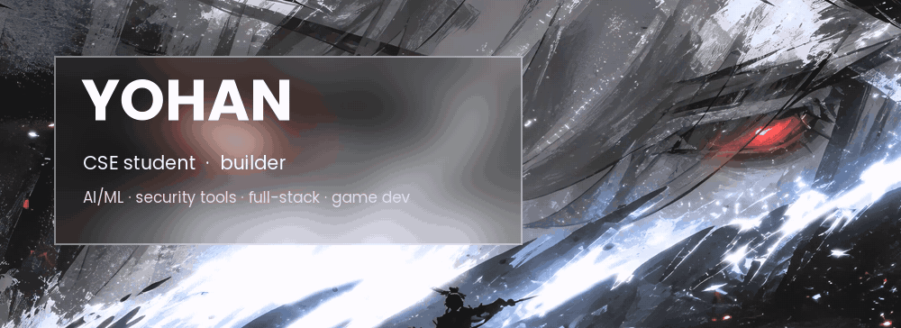
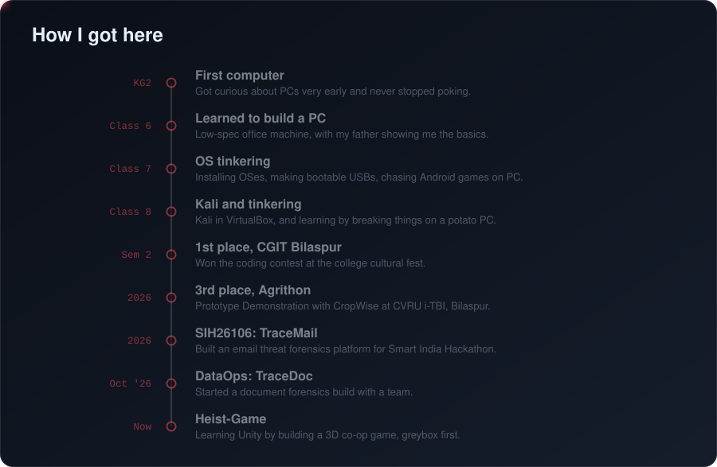
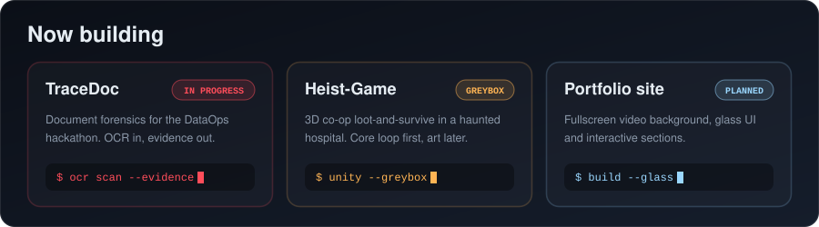

### [ ✦ Enter the interactive portfolio → ](https://yohan-987.github.io)

 

## About

3rd-semester CSE student from Chhattisgarh, India. I've been taking PCs apart since primary school, and these days I build security tooling, AI/ML-backed features, full-stack apps and the occasional game. Beginner but Always learning.................

| Status | Details |
|---|---|
| 🔭 **Building now** | TraceDoc (document forensics), Heist-Game (Unity), this portfolio |
| 🌱 **Learning** |Machine Learning , DSA ,Basic Unity and C#  |
| 🎓 **Studying** | B.Tech CSE, 2nd year |
| 🤝 **Open to** | Hackathon teammates and honest code reviews |
| 🧪 **Origin story** | Trying to run heavy games and software on a potato PC, tinkering with OS settings and accidentally corrupting the OS |

 

 

## Featured projects

<table>
<tr>
<td width="50%" valign="top">

### [TraceMail](https://github.com/yohan-987/TraceMail) `prototype`
Evidence-aware email threat investigation. Header forensics, SPF/DKIM/DMARC, origin tracing, a campaign graph, an ML content classifier, and risk scoring that keeps forensic evidence and content signals separate.
 `TypeScript` `Node.js` `React` `Cytoscape`

</td>
<td width="50%" valign="top">

### [TraceDoc](https://github.com/yohan-987/TraceDoc) `in progress`
AI-powered document forensics and contextual intelligence for the DataOps hackathon, with an OCR pipeline feeding an evidence engine.

</td>
</tr>
<tr>
<td width="50%" valign="top">

### [CropRetain / CropWise](https://github.com/yohan-987/CropRetain) `demo`
Farmer-to-buyer marketplace behind my Agrithon podium. Partner reputation, negotiation flow and verification, with price forecasting and quality grading models planned.
 `Web` `ML`

</td>
<td width="50%" valign="top">

### [GDG Peer Learning](https://github.com/yohan-987/gdg-peer-learning) `dropped`
Campus learning platform organised by GDG tracks. Quizzes and badges, project submissions, a doubt board and a contribution leaderboard.
 `React` `TypeScript` `Tailwind` `Firebase`

</td>
</tr>
<tr>
<td colspan="2" valign="top">

### [Heist-Game](https://github.com/yohan-987/Heist-Game) `work in progress`
A 3D co-op loot-and-survive game set in a haunted hospital, where stealing medicine keeps you sane. Greybox phase, solo first, multiplayer later.
 `Unity` `C#`

</td>
</tr>
</table>

 

 

 

## Tech stack

**Languages**

**Web and backend**

**AI/ML and data**

**Game dev**

 

## GitHub analytics

<picture>
  <source media="(prefers-color-scheme: dark)" srcset="https://raw.githubusercontent.com/yohan-987/yohan-987/output/github-snake-dark.svg">
  
</picture>

 

## Currently exploring

- Machine learning and AI 
- Game architecture in Unity: input, interaction and loot loops
- Making risk scores honest about what they don't know

## Say hi

Pick a rating and tell me what you think of the profile. Each link opens a pre-filled issue on this repo.

[1 ⭐](https://github.com/yohan-987/yohan-987/issues/new?title=Profile%20feedback%3A%201%2F5) · [2 ⭐](https://github.com/yohan-987/yohan-987/issues/new?title=Profile%20feedback%3A%202%2F5) · [3 ⭐](https://github.com/yohan-987/yohan-987/issues/new?title=Profile%20feedback%3A%203%2F5) · [4 ⭐](https://github.com/yohan-987/yohan-987/issues/new?title=Profile%20feedback%3A%204%2F5) · [5 ⭐](https://github.com/yohan-987/yohan-987/issues/new?title=Profile%20feedback%3A%205%2F5)

 

